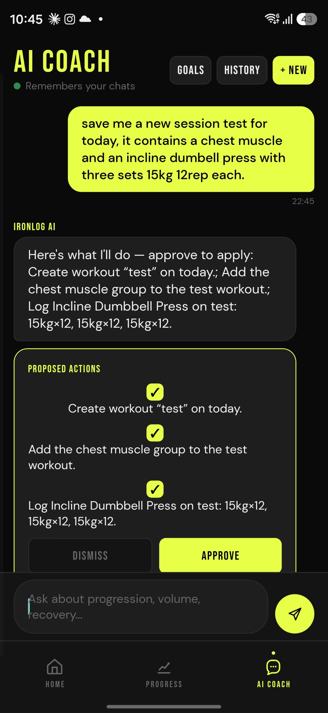
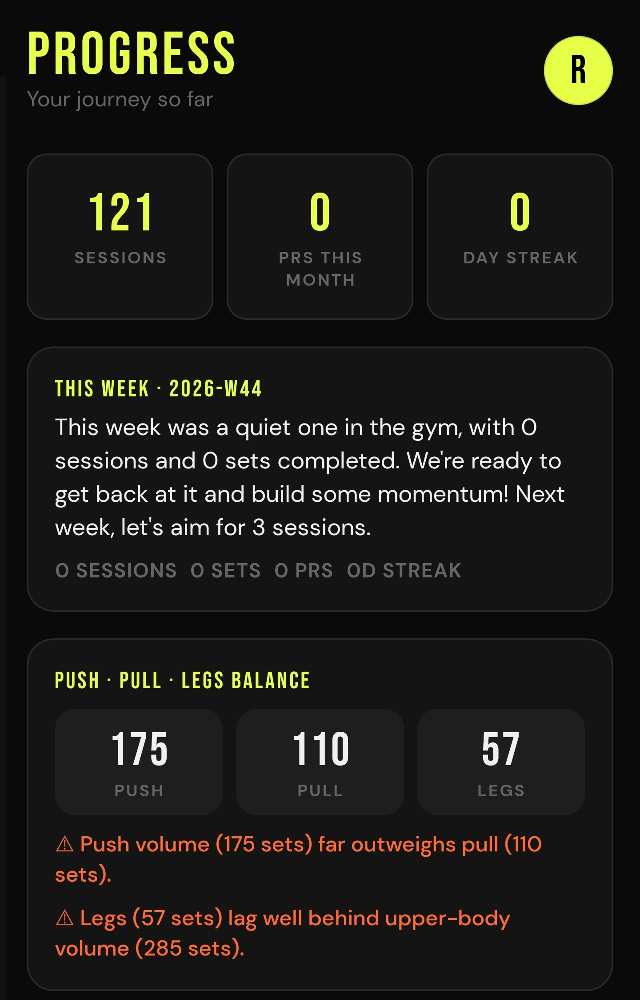
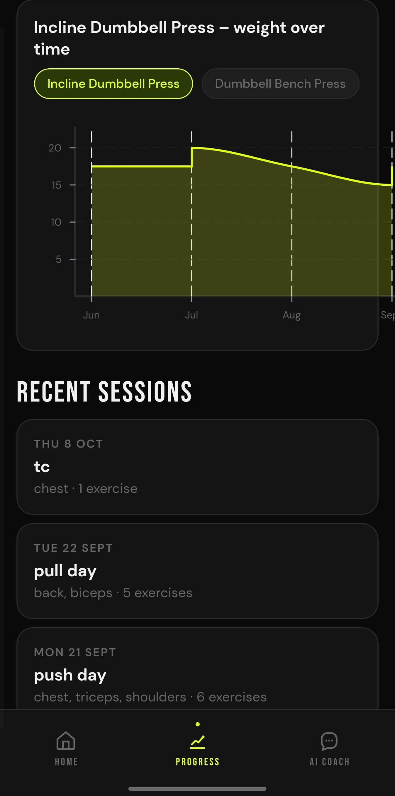
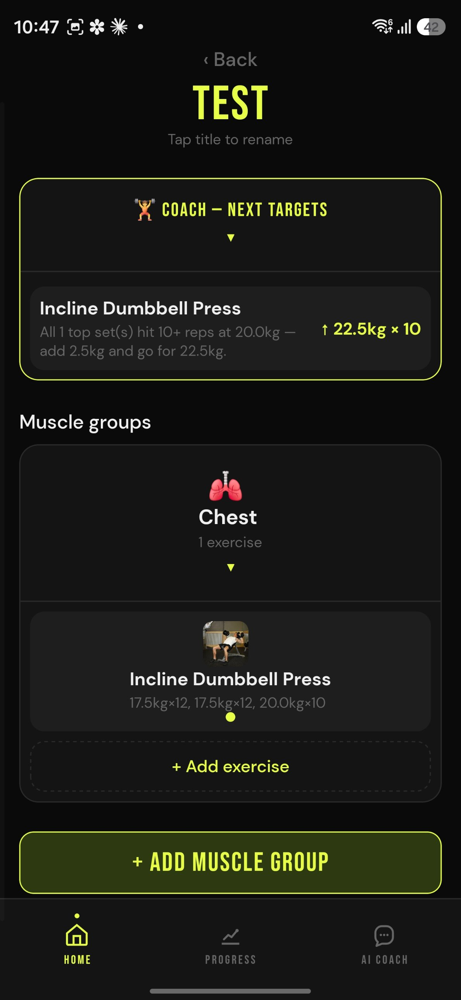
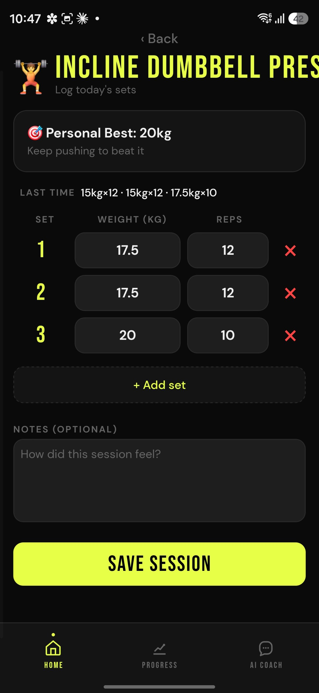
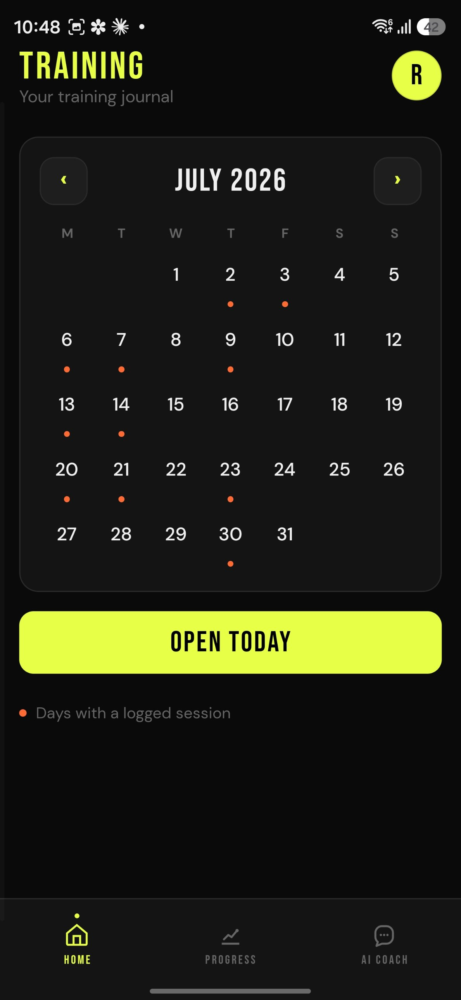

# IronLog 🏋️

**A dark, high-energy gym tracker with an agentic AI coach that logs, plans, and
reschedules your training for you — on your say-so.**

[](https://github.com/IronLogEfitness/Efitness_frontend/actions/workflows/ci.yml)
[](LICENSE)

Expo + React Native + TypeScript mobile app. Backend (FastAPI + MongoDB + the
Gemini agent) lives in a separate repo:
**[IronLogEfitness/Efitness_backend](https://github.com/IronLogEfitness/Efitness_backend)**.

📱 **[Download the latest Android APK](https://github.com/IronLogEfitness/Efitness_frontend/releases/latest/download/ironlog.apk)**

## Screenshots

| AI coach — human-in-the-loop | Progress dashboard | Progression chart |
| --- | --- | --- |
|  |  |  |

| Workout + next targets | Session logging | Training calendar |
| --- | --- | --- |
|  |  |  |

## Features

- 🤖 **Agentic AI coach** — chat with a Gemini-powered coach that reads your real
  training data and can *act* on it: log sets, create and reschedule workouts, set
  goals. Every write is a **proposal you approve** (human-in-the-loop) before it's
  applied — nothing happens behind your back.
- 📈 **Progress dashboard** — overall stats, per-muscle breakdown, consecutive-day
  streak, PRs this month, and a weight-over-time chart per exercise.
- 💪 **Session logging with live PR detection** — log sets against an exercise and
  get a personal-record badge (and a celebratory haptic) the moment you beat your
  best.
- 🗓️ **Agenda** — a calendar of training days; each day holds titled workouts with
  their muscle groups and logged exercises.
- 🎯 **Goals** — set a target lift and date; the app projects whether you're on
  track.
- 💬 **Persistent chat memory & references** — conversations are saved, summarised
  as they grow, and importable (incl. from Gemini share links); publish a chat as
  a labelled reference the coach can pull into future answers.
- 🔒 **Auth** — JWT with the token kept in `expo-secure-store`; a global 401
  interceptor drops you back to sign-in when the session expires.
- 📴 **Offline-aware** — server state is cached (React Query + AsyncStorage), so a
  cold or offline launch shows your last data and refetches in the background.

## Tech stack

- **Expo (SDK 54)** + **React Native 0.81** + **TypeScript**
- **React Navigation** — auth stack, bottom tabs, per-area stacks
- **TanStack Query (React Query)** — all server state, with offline persistence
- **Victory Native** — progress charts
- **axios** — typed API client with request/response interceptors
- **expo-secure-store** — secure token storage; **expo-haptics** — tactile feedback
- **jest** + **jest-expo** — unit tests; **ESLint** (`eslint-config-expo`) + `tsc`

## Architecture

Feature-first and deliberately thin:

- `src/services/api.ts` — the single typed axios client: `BASE_URL` (env-driven,
  see below), a request interceptor that attaches the Bearer token, and a response
  interceptor that handles global 401s. All endpoint functions live here.
- `src/services/AuthContext.tsx` — auth state + token rehydration; exposes stable
  (`useCallback`) actions and receives the API layer's unauthorized callback.
- `src/services/queryClient.ts` — the shared React Query client + AsyncStorage
  persister.
- `src/hooks/*` — one file per domain (exercises, workouts, progress, goals,
  coach, conversations) wrapping the API functions in `useQuery`/`useMutation`
  with cache invalidation. Screens consume these, not `useEffect` + `useState`.
- `src/navigation/RootNavigator.tsx` — auth stack vs. the main tabs, gated on auth.
- `src/components/*` — shared UI: design tokens (`theme.ts`), `ScalePressable`
  (accessible button), skeleton loaders, a root `ErrorBoundary`.
- `src/screens/*` — the screens.

## Getting started

Prerequisites: **Node.js 20+** and the Expo tooling (via `npx`, no global install
needed).

```bash
npm install
npx expo start --clear
```

Then open Android, iOS, or web from the Expo CLI.

### Configuration

The API base URL is env-driven. Copy `.env.example` to `.env` to point the app at
a different backend (local/staging) without editing source; unset, it falls back
to the production URL.

```bash
# .env
EXPO_PUBLIC_API_URL=http://192.168.1.10:8000   # your local backend, for example
```

## Tests, lint, type-check

```bash
npm run typecheck   # tsc --noEmit
npm run lint        # expo lint (ESLint)
npm test            # jest
```

CI (`.github/workflows/ci.yml`) runs all three on every push to `main` and every PR.

## Releases

Android APKs are published to **[GitHub Releases](https://github.com/IronLogEfitness/Efitness_frontend/releases)**;
the newest is always at the download link above. An in-app check prompts when a
newer release is available.

## License

[MIT](LICENSE).
